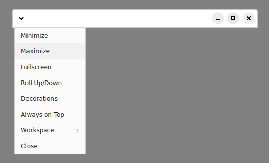
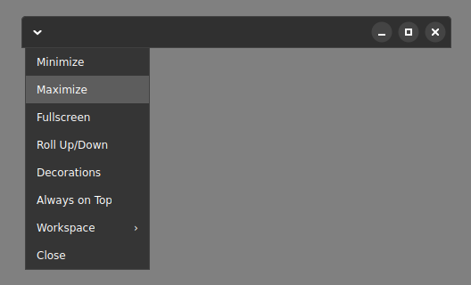
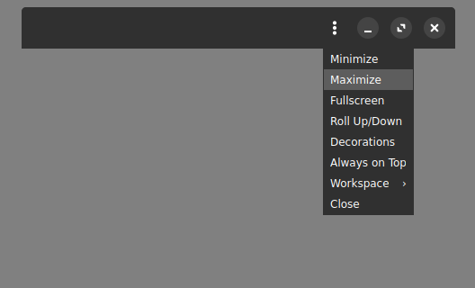
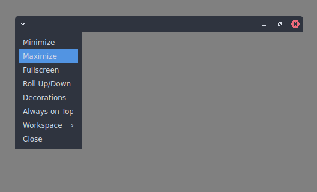
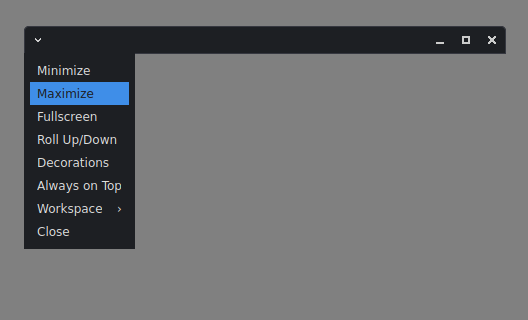
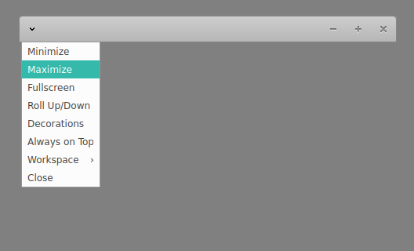
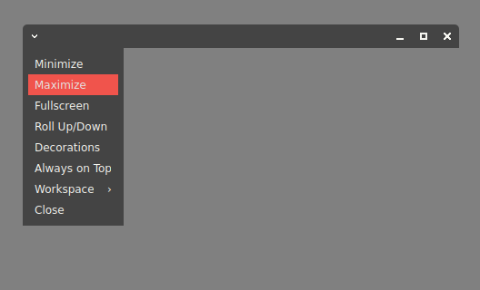
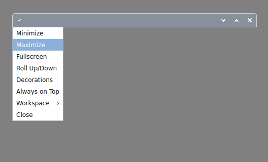
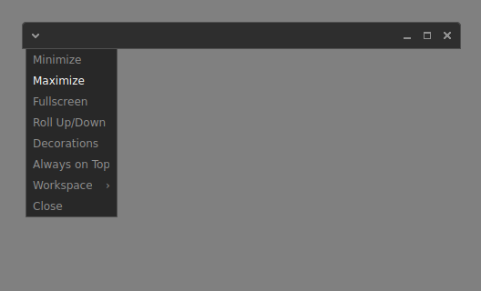
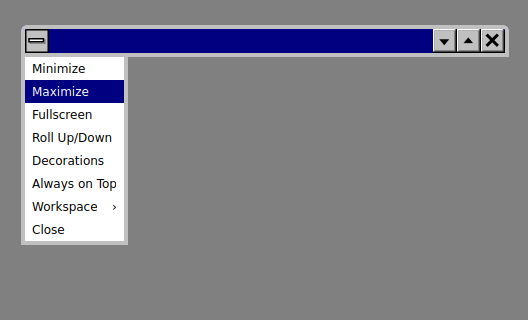

# Overview

This repository contains Server Side Decoration (SSD) themes for `labwc`.

Why?

Because:

1. It is hard to achieve compositor and cross-toolkit visual uniformity, and
   increasingly so as (a) there is a shift in how Gtk4 views theming and what
   it considers supported; (b) Qt handles themes differently between QWidgets
   and QtQuick; (c) there are other toolkits in use, for example `iced-rs`,
   `tk` and whatever is used by electron based applications.
2. It is better to avoid chasing Qt/Gtk internal visuals; and not treating
   toolkits as theme providers. In other words, trying to parse Gtk CSS and
   Kvantum files on the fly is a bad idea.
3. It is good to build compositor themerc files and icons to be consistent
   with (not identical to) popular Gtk/Qt/other themes. The term 'consistency'
   here is meant to refer to matched behaviour rather than pixel perfection.

# Install

If you want to install these themes locally (for example if they are not
packaged on your favourite distro), just run the commands below and the themes
will be installed to `~/.local/share/themes/`.

```
meson setup build --prefix=$HOME/.local
meson install -C build
```

For system-wide packaging just set `--prefix` to `/usr` or whatever.

# Themes

## Screenshots of common themes

### labAdwaita



### labAdwaita-dark



### labAdwaita-Papirus-dark



### labArc-xbm



### labCombine-xbm



### labGreybird-geeko



### labNumix-xbm



### labPiXflat-xbm



### labTeallach



### labdows31



## Additional Notes

### labCombine-xbm

Inspired by Numix

### labAdwaita-Papirus-dark

This theme tries to mimic the appearance of the
[Adwaita 1.5 Dark GTK](https://gnome.pages.gitlab.gnome.org/libadwaita/) theme
and [colors](https://gnome.pages.gitlab.gnome.org/libadwaita/doc/1.5/named-colors.html)
together with the Pairus Dark icon theme.

Recommended `rc.xml` theme settings:

```xml
<theme>
  <name>Adwaita-Papirus-Dark</name>
  <titlebar layout=":menu,iconify,max,close" showTitle="yes" />
  <cornerRadius>14</cornerRadius>
  <dropShadows>yes</dropShadows>
  <font place="ActiveWindow" name="Cantarell" size="12" weight="bold" />
  <font place="InactiveWindow" name="Cantarell" size="12" weight="bold" />
  <font place="MenuHeader" name="Cantarell" size="12" weight="bold" />
  <font place="MenuItem" name="Cantarell" size="12" />
  <font place="OnScreenDisplay" name="Cantarell" size="12" />
</theme>
```

Recommended Gnome Tweaks settings:

- Appearance
  - Icons: Papirus-Dark
  - Legacy Applications (GTK3): Adw-gtk3-dark
- Titlebar Buttons
  - Maximize: On
  - Minimize: On
  - Placement: Right

The icons are based on the icons found in the [Adwaita-dark button theme](https://github.com/labwc/labwc-artwork/tree/main/button-themes/svg/Adwaita-dark)
in this repository and on the icons of the great [Papirus icon theme](https://github.com/PapirusDevelopmentTeam/papirus-icon-theme).

Obligatory screenshot:


