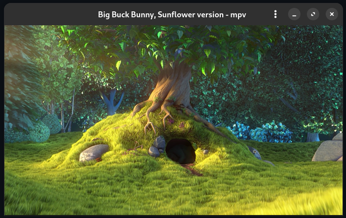

# Install

```
meson setup build --prefix=$HOME/.local
meson install -C build
```

# Themes

## labCombine-xbm

Inspired by Numix

## labAdwaita-Papirus-dark

This theme tries to mimic the appearance of the
[Adwaita 1.5 Dark GTK](https://gnome.pages.gitlab.gnome.org/libadwaita/) theme
and [colors](https://gnome.pages.gitlab.gnome.org/libadwaita/doc/1.5/named-colors.html)
together with the Pairus Dark icon theme.

Recommended `rc.xml` theme settings:

```xml
  <theme>
    <name>Adwaita-Papirus-Dark</name>
    <titlebar layout=":menu,iconify,max,close" showTitle="yes" />
    <cornerRadius>14</cornerRadius>
    <dropShadows>yes</dropShadows>
    <font place="ActiveWindow" name="Cantarell" size="12" weight="bold" />
    <font place="InactiveWindow" name="Cantarell" size="12" weight="bold" />
    <font place="MenuHeader" name="Cantarell" size="12" weight="bold" />
    <font place="MenuItem" name="Cantarell" size="12" />
    <font place="OnScreenDisplay" name="Cantarell" size="12" />
  </theme>
```

Recommended Gnome Tweaks settings:

- Appearance
  - Icons: Papirus-Dark
  - Legacy Applications (GTK3): Adw-gtk3-dark
- Titlebar Buttons
  - Maximize: On
  - Minimize: On
  - Placement: Right

The icons are based on the icons found in the [Adwaita-dark button theme](https://github.com/labwc/labwc-artwork/tree/main/button-themes/svg/Adwaita-dark)
in this repository and on the icons of the great [Papirus icon theme](https://github.com/PapirusDevelopmentTeam/papirus-icon-theme).

Obligatory screenshot:


